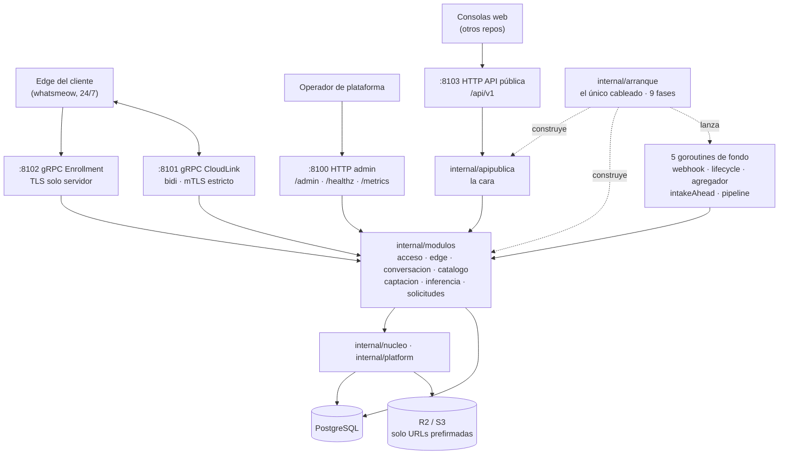
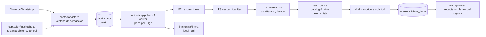

# Arquitectura de `wapp-cloud-platform`

> Organizado **por dominios**, no por carpetas: la carpeta es un detalle, el dominio es la
> frontera. Al final se dice **dónde se rompen** esas fronteras, con la línea exacta.
>
> Medido contra el código el **2026-10-11**. Cada cifra lleva el comando o la regla con que se
> contó; las rutas, las variables y las tablas no se cuentan aquí: son de
> [`contratos.md`](contratos.md) y de [`esquema-postgres.md`](esquema-postgres.md).

---

## 1 · La forma general: un proceso, cuatro listeners, nueve fases

No es hexagonal global. Es **modular por capacidad**: `internal/` tiene seis directorios y cada
uno tiene un papel distinto.

| Directorio | Qué es | Quién puede importarlo |
|---|---|---|
| `internal/modulos/` | Los **siete módulos de negocio**: `acceso`, `edge`, `conversacion`, `catalogo`, `captacion`, `inferencia`, `solicitudes` | Otro módulo solo si la tabla de fronteras lo permite (§4); la cara y el arranque, siempre |
| `internal/nucleo/` | Lo que es de todos y de ninguno: la identidad opaca del contacto (`internal/nucleo/contact`) | Todo el árbol |
| `internal/platform/` | Soporte transversal sin negocio: configuración, cifrado de campo, HTTP base, log, métricas, rate-limit, Postgres y almacén de objetos | Todo el árbol |
| `internal/apipublica/` | **La cara**: la única superficie HTTP pública, el `:8103` entero | Solo el arranque |
| `internal/arranque/` | El **composition root**: construye los objetos en orden y levanta los listeners | Solo `cmd/server` |
| `internal/candados/` | La lógica de los candados que vigilan todo lo anterior (§4.3) | Los tests-candado y `cmd/cobertura-ficheros` |

La única zona hexagonal (`domain` / `usecase` / `ports` / `infra` / `transport`) es
`internal/modulos/acceso/iam/`, y es deliberado.

Todo se cablea en **nueve fases** que comparten un contenedor de campos **privados**
(`internal/arranque/contenedor.go`): por eso el composition root es un solo paquete y no nueve.

🔴 **Para saber qué existe de verdad en esta pieza se lee
[`internal/arranque/orquestador.go`](../internal/arranque/orquestador.go)**: la lista `fases`
(`orquestador.go:53`) cabe en una pantalla, y después se abre el fichero de la fase que interese.

| # | Fichero de `internal/arranque/` | Nombre en el log | Qué construye | Hitos que exige |
|---|---|---|---|---|
| 1 | `fase1_infraestructura.go` | `infraestructura` | métricas · BD y migraciones · PKI · lease · enrolamiento | — |
| 2 | `fase2_autenticacion.go` | `autenticación` | el plano de autenticación de usuario del IAM y el JWKS del Edge | `db` |
| 3 | `fase3_almacenes.go` | `almacenes` | el cifrado de PII (KEK) y los adaptadores de salida | `db` |
| 4 | `fase4_gateway.go` | `gateway` | el gateway gRPC que termina el túnel de cada Edge | `lease` `enroll` `cipher` `almacenes` `auth` `metricas` |
| 5 | `fase5_captacion.go` | `captación (stack LLM)` | el selector de vía, las etapas P2→P5, el aforo y el worker | `gateway` `almacenes` `cipher` |
| 6 | `fase6_solicitudes.go` | `solicitudes` | la bandeja del dueño y sus dos recordatorios perezosos | `gateway` `almacenes` |
| 7 | `fase7_flujos.go` | `flujos` | el Motor de Flujos y los ganchos que le cuelgan del gateway | `gateway` `selector` `almacenes` `solicitudes` |
| 8 | `fase8_transporte.go` | `transporte` | los cuatro listeners y sus rutas | `gateway` `flujos` `auth` `pki` `almacenes` |
| 9 | `fase9_fondo.go` | `goroutines de fondo` | las cinco goroutines de larga vida (§5) | `almacenes` `selector` `flujos` |

Cada fase declara en `requiere()` los hitos que da por cumplidos, y `construir`
(`orquestador.go:102`) los comprueba **antes** de ejecutarla: el orden no es una promesa escrita
en comentarios. Un arranque caído dice por qué fase iba
(`arranque: fase 1/9 "infraestructura": …`), y uno que arranca deja una línea
`arranque: fase completada` por fase, con los milisegundos que tardó.

| Listener | Variable | Default | Qué expone |
|---|---|---|---|
| HTTP admin/health | `WAPP_HTTP_ADDR` | `:8100` | `/healthz`, `/metrics`, `/admin/*` |
| gRPC CloudLink | `WAPP_GRPC_CONNECT_ADDR` | `:8101` | `Connect` bidi, **mTLS estricto** |
| gRPC Enrollment | `WAPP_GRPC_ENROLL_ADDR` | `:8102` | `EnrollEdge`, **TLS solo de servidor** (el Edge enrola antes de tener certificado) |
| HTTP API pública | `WAPP_PUBLIC_HTTP_ADDR` | `:8103` | `/api/v1/*` |

Los cuatro defaults están en `internal/platform/config/config.go:623`.

⚠️ El listener público **no tiene sonda de salud**: `/healthz` solo existe en `:8100`. Lo fija la
huella del arranque (`internal/arranque/testdata/huella-vieja.golden`), donde `/healthz` y
`/metrics` aparecen únicamente bajo `:8100`.

---

## 2 · Los dominios

Los siete módulos de `internal/modulos/`, de un vistazo. Las secciones de abajo recorren los
dominios uno a uno y dicen en qué módulo vive cada cosa.

| Módulo | Qué resuelve | Paquetes |
|---|---|---|
| `acceso` | Identidad y gobierno multi-empresa | `iam/…` · `platformadmin` · `entitlements` |
| `edge` | El túnel con cada Edge y lo que sube por él | `grpc` · `enroll` · `lease` · `session` · `fleet` · `diagnostics` · `inferstats` · `receipts` · `ingest` · `filtercfg` |
| `conversacion` | El Motor de Flujos y el turno acotado | `engine` · `model` · `modules` (+ `cart` `menu` `survey` `media`) · `runtime` · `store` · `trigger` · `events` · `content` · `admin` · `turnoacotado` |
| `catalogo` | El catálogo del tenant, su importación y su índice | el paquete raíz · `catalogimport` · `indice` |
| `captacion` | El pipeline que convierte una conversación en un caso | `intake` · `intakeahead` · `stages` · `pipeline` · `anclaje` · `evidence` · `reanalisis` · `casebank` · `intentcfg` |
| `inferencia` | La vía LLM, los prompts P2–P5, el LLM del tenant y la degradación | `llmvia` (+ `local`) · `prompts` · `tenantllm` · `degradation` |
| `solicitudes` | Las solicitudes resultantes y lo que las entrega | `intakes` (+ `quotetext` `telemetria`) · `integrations` (+ `crmpush` `sigv1`) · `tenantvars` |

Junto a casi cada paquete con un puerto persistente hay un paquete hermano acabado en
`helpertest` (por ejemplo `internal/modulos/edge/lease/leasehelpertest`): trae la **suite de
contrato** del puerto y su doble en memoria. Es soporte de tests compilado como paquete normal;
no es dominio y el servidor no lo cablea.

### 2.1 · IAM — `internal/modulos/acceso/iam/` (la única zona hexagonal)

Canje **Identity Token → Context Token** (ES256), RBAC glob multi-tenant, roles y grants,
membresías, invitaciones de un solo uso y **empresa activa**. Aquí **no hay usuarios ni
contraseñas**: las valida identity-core (ver I-CP-9 en [`constitucion.md`](constitucion.md)).

Subpaquetes: `domain` (entidades y errores tipados), `usecase` (canje, grants, delegación,
invitaciones, empresa activa), `ports/in` y `ports/out`, `infra/postgres`, `infra/memory` e
`infra/identity` (este último habla con el SSO del grupo, incluido el plano M2M), y
`transport/http`.

### 2.2 · Gateway — `internal/modulos/edge/`

La terminación de los túneles de cada Edge. Cuatro piezas:

- **`grpc`** — el servidor `Connect` bidi. `route()` despacha **10** tipos de `EdgeToCloud`
  (`internal/modulos/edge/grpc/connect_route.go:45`; regla: los `case` del `switch` de esa
  función). Regla de diseño explícita: el bucle `Recv` **suelta el trabajo** a un carril por
  sesión, y se quedan **inline** solo los mensajes que son O(1) en memoria (`Ack`,
  `InferenceResult`), porque son las víctimas del head-of-line, no su causa.
- **`enroll`** — la CA propia y `EnrollEdge`: CSR + código de un solo uso → certificado.
- **`lease`** — emisión, renovación y revocación de leases. **Es el lado servidor de la doble
  llave** (I-ECO-2).
- **`session`** / **`fleet`** — el registro de streams vivos en memoria y el estado
  online/offline **durable** en `fleet_sessions`.

Del mismo módulo cuelga lo que **sube** por el túnel: `ingest` (dedupe de entrantes por
`(session_id, wa_message_id)`), `receipts` (acuses `delivered`/`read`), `diagnostics`,
`inferstats` (§2.7) y `filtercfg` (la configuración de filtros que se empuja al Edge).

### 2.3 · Motor de flujos y módulos — `internal/modulos/conversacion/`

Una máquina de estados dinámica con dos puertos (la fuente de contenido y el sumidero de
eventos) y un **registro de módulos enchufables**.

| Paquete | Qué es |
|---|---|
| `engine` | El núcleo **puro**: no conoce BD ni transporte |
| `model` | `Flow` / `Node` / `Conversation` + su JSON y validación |
| `modules` | El registro de módulos por tipo de nodo y las coerciones de payload |
| `modules/cart` | El carrito conversacional (catálogo → ítems → cierre). El módulo grande, con diferencia |
| `modules/menu` · `survey` · `media` | Menú numerado · pregunta de encuesta de opción cerrada · envío de PDF/imagen |
| `runtime` | La orquestación viva: entrante → tenant y conversación → engine → efectos → sinks, agregador de ráfagas, políticas de reanudación |
| `store` | Persistencia del motor: definiciones, estado, eventos y los puertos estrechos que usan otros módulos |
| `trigger` | Ante un entrante sin conversación viva, decide qué flujo arranca (o el fallback, o nada) |
| `events` | El **evento conversacional**: instancia viva de una capacidad para (tenant, sesión, contacto) |
| `content` · `admin` | El puerto de contenido · los handlers de publicar definición, abrir conversación y reglas de disparo |
| `turnoacotado` | Nivel B: una pregunta suelta al modelo cuando un módulo determinista no entendió |

**Módulos registrados en producción: exactamente cuatro**, y se ven en una línea cada uno —
`internal/arranque/fase7_flujos.go:57` menu, `:59` survey, `:69` cart, `:70` media.

La identidad **opaca** del contacto (PII cifrada con KEK versionada + índice ciego HMAC) no es de
este módulo: vive en `internal/nucleo/contact`, porque la usan también `edge` y `solicitudes`.

### 2.4 · Solicitudes y pipeline LLM — `captacion`, `inferencia` y `solicitudes/intakes`

**Un pedido y un presupuesto son el mismo objeto** (la solicitud, tabla `intakes`), con una
máquina de **11 estados** más un alias legado (`closed`), declarados en
`internal/modulos/solicitudes/intakes/status.go:23` (regla: las constantes `Status…` de ese
bloque, sin contar `StatusClosedLegacy`).

El camino, de mensaje a borrador:

| Paquete | Módulo | Qué es |
|---|---|---|
| `intake` | `captacion` | **La cola**: la tabla `intake_jobs` y el puerto estrecho por el que se escribe |
| `stages` | `captacion` | Las etapas, una por fichero: P2, P3, P4, `match` y `draft` |
| `pipeline` | `captacion` | **El worker**: reclama un job, encadena las etapas, y lo termina o lo castiga con la causa escrita |
| `anclaje` | `captacion` | A qué línea pertenece cada adjunto. **Determinista, sin LLM**. Lo importan `stages` y `pipeline` |
| `intakeahead` | `captacion` | Adelanto de la ventana **por pull**; `DefaultWorkers = 4` (`internal/modulos/captacion/intakeahead/intakeahead.go:108`) |
| `evidence` | `captacion` | La regla de la evidencia: ¿la frase que el modelo dice citar está de verdad en el texto? |
| `reanalisis` | `captacion` | El caso de uso de `POST /api/v1/intakes/{id}/reanalyze` |
| `casebank` | `captacion` | Banco de casos anonimizados **con consentimiento** (se siembra con `cmd/casebank`) |
| `intentcfg` | `captacion` | El catálogo de intenciones por tenant. **Aquí vive «P1»** (§3.3 de `constitucion.md`) |
| `intakes` | `solicitudes` | El dominio de la solicitud: cabecera, líneas, estados, revisiones y datos del comprador (PII cifrada) |
| `intakes/quotetext` | `solicitudes` | **P5**: redacta la cotización con la voz del negocio |
| `llmvia` | `inferencia` | 🔴 El **único paquete que pregunta por la vía** (`local` \| `api`), más el decorador que avisa al dueño cuando la vía falla |
| `llmvia/local` | `inferencia` | El provider que habla con el **Ollama del Edge del tenant** por frames CloudLink |
| `prompts` | `inferencia` | Carga de disco el texto ajustable de P2–P5 (`WAPP_LLM_PROMPTS_DIR`) |
| `tenantllm` | `inferencia` | La vía del tenant y su credencial de proveedor, **cifrada** |
| `degradation` | `inferencia` | El aviso al dueño cuando el LLM cae al Nivel A (determinista) |

🔴 **La inferencia la orquesta ESTE repo; el Edge solo la sirve** (I-CP-2). El prompt lo
construyen aquí `wapp-shared/llm` e `internal/modulos/inferencia/prompts`; el Edge recibe
*prompt entra → JSON sale*.

### 2.5 · Catálogo — `internal/modulos/catalogo/`

Tres paquetes: el **raíz** (el modelo del catálogo de dos niveles, categorías → artículos, y su
parser), `catalogimport` (el import en dos formas: **estricta**, JSON validado, y **tabular**,
planilla; tope de artículos por `WAPP_IMPORT_MAX_ITEMS`, más una plantilla y un prompt de ayuda
para preparar el fichero) e `indice` (el índice en memoria que la etapa `match` consulta una vez
por ítem).

Lo leen tres consumidores: el módulo `cart` (solo el paquete raíz), el pipeline de `captacion`
(el índice) y la cara (el import).

### 2.6 · Entitlements — `internal/modulos/acceso/entitlements`

Los derechos comerciales por tenant: `Has`, `ListEffective` y `CacheTTL`
(`internal/modulos/acceso/entitlements/postgres.go:136`), más el middleware `RequireFeature`
(`internal/modulos/acceso/entitlements/middleware.go:46`) que **gatea rutas**. Fail-closed
(I-CP-6), con caché en memoria por TTL.

Los planes y las features sembradas: [`esquema-postgres.md`](esquema-postgres.md) §7.

### 2.7 · Telemetría y flota

- **`internal/platform/metrics`** — el registro Prometheus (la lista de métricas y la regla para
  recontarlas, en [`contratos.md`](contratos.md) §8).
- **`internal/platform/metrics/flowlifecycle`** — el colector incremental que lee el outbox
  append-only `flow_events` hacia `/metrics`, para que la tabla no sea write-only.
- **`internal/modulos/edge/inferstats`** — el parte de inferencia que llega en el `Heartbeat` del
  Edge, agregado **en memoria**. El tipo con que se lo entrega a las métricas vive en
  `internal/platform/metrics/inferencia`, precisamente para que `platform` no importe a `edge`.
- **`internal/modulos/edge/diagnostics`** — diagnóstico remoto **bajo demanda** de la flota, con
  TTL y consentimiento por tenant.
- **`internal/modulos/solicitudes/intakes/telemetria`** — deja las mediciones de la bandeja del
  dueño en `flow_events` (los eventos, en [`contratos.md`](contratos.md) §9).

### 2.8 · CRM — `internal/modulos/solicitudes/integrations`

El puente CRM es una **pieza independiente**; este repo congela el contrato `wapp-crm-v1`
(`docs/contracts/wapp-crm-v1/`). Tres verbos, **dos implementados**:

| Verbo | Dirección | Estado |
|---|---|---|
| `intake.push` | wApp → puente | **Implementado**: `crmpush` lo arma y lo encola en la cola durable `webhook_outbox`; el worker lo entrega firmado |
| `intake.status` | puente → wApp | **Implementado**: `POST /api/v1/integrations/callback` |
| `catalog.pull` | puente → wApp | **NO implementado**: configurar su adaptador `http` responde **422** «catalog.pull diferido» (`internal/apipublica/integrations_validate.go:96`) |

`sigv1` es HMAC-SHA256 sobre el cuerpo crudo, con comparación en **tiempo constante**
(`internal/modulos/solicitudes/integrations/sigv1/sigv1.go:61`). La ventana anti-replay de
±300 s la aplica quien llama, no el paquete.

### 2.9 · La cara — `internal/apipublica`

**No es un dominio: es la cara.** Una `Cara` es un `http.ServeMux` propio más la lista de
patrones que se le registraron. La construye `caraNueva` (`internal/arranque/mudanzas.go:130`)
llamando a un montador `Mount…` por área; cada montador decide qué dependencia ausente apaga qué
ruta, y delega en los módulos de arriba. La lista de rutas es de
[`contratos.md`](contratos.md) §2.

Sus dos cadenas de middleware (`internal/apipublica/chain.go:110` y `:127`):

- `protect(...)` = `accessLog → Authenticate → annotateTenant → RequirePermission(scope) → AuditMiddleware → h`
- `protectRead(...)` = igual **sin auditoría** (una lectura no tiene efecto que registrar)

Envoltura global de la cara (`internal/arranque/http.go:178`):
`InstrumentHTTP("public") → PublicRateLimit → cara`.

El listener admin es otra cosa y no pasa por la cara: sus rutas las cablea **una sola función**,
`registerAdminRoutes` (`internal/arranque/rutas_admin.go:68`), con
`adminHandler` = autenticación + permiso + auditoría.

### 2.10 · Los dominios pequeños y el soporte

- **`internal/modulos/acceso/platformadmin`** — la vía del **operador de plataforma**: bandeja de
  empresas, instalaciones, códigos de enrolamiento, solicitudes de acceso y alta pública
  (`POST /api/v1/signup`). Es el módulo cuyo nombre detecta el candado de I-CP-5.
- **`internal/modulos/solicitudes/tenantvars`** — las variables de empresa: pares clave→valor
  que el tenant define y que wApp **no interpreta**.
- **`internal/nucleo/`** — `contact` (la identidad opaca del contacto, §2.3) y `errhelpertest`
  (afirmaciones sobre errores que comparten los tests).
- **`internal/platform/`** — soporte transversal, **no es dominio**: `config`, `crypto` (cifrado
  de campo, rotación de KEK, KMS), `httpapi` (health, admin, middleware de autenticación,
  auditoría y rate-limit HTTP), `logging`, `metrics`, `ratelimit`, `storage/postgres` (conexión,
  health y el runner de migraciones) y `storage/objectstore` (R2).
- **`internal/candados/`** — la lógica de los candados (§4.3). No la cablea el servidor.
- **`internal/arranque/huellatest`** — calcula la **huella** de un arranque: lo que el proceso
  expone (rutas por listener, rpc, familias de métricas) y lo que su código lanza y cablea
  (sentencias `go`, ganchos de métricas).

---

## 3 · Puntos de entrada: un servicio y cinco herramientas

`cmd/` tiene seis `main`. **Uno solo es el servicio.**

| `cmd/` | Qué hace |
|---|---|
| `cmd/server` | **El proceso real.** `main.go` son 36 líneas y delega en `arranque.Ejecutar` (`internal/arranque/orquestador.go:67`), que carga la configuración, corre las nueve fases —migra al arrancar—, levanta los cuatro listeners y hace cierre ordenado |
| `cmd/migrate` | Aplica el DDL **y sale**, sin listeners. `-status` solo consulta (`cmd/migrate/main.go:43`). Lee las **mismas** `WAPP_DB_*` que el servidor, nunca un argumento |
| `cmd/prompts` | `-volcar <dir>` escribe las plantillas de P2–P5 con el texto que corre hoy; `-comprobar <dir>` las valida sin arrancar (`cmd/prompts/main.go:44`) |
| `cmd/casebank` | `-tenant X -consentido` siembra un caso en el banco de casos y sale. **Sin `-consentido` se niega** (`cmd/casebank/main.go:54`) |
| `cmd/cobertura-ficheros` | El **informe** de cobertura por fichero: lee un perfil de `go test -coverprofile` e imprime el porcentaje de cada fichero. Lo llama `make cobertura-ficheros`; no bloquea por un fichero bajo |
| `cmd/debug_inferencia` | Herramienta de laboratorio: corre el clasificador y el pipeline contra un Ollama local (`-model`, `-ollama`, `-force-pipeline`). No importa nada de `internal/` y no forma parte del servicio |

Tienen tests `cmd/server`, `cmd/casebank` y `cmd/cobertura-ficheros`; `cmd/migrate`,
`cmd/prompts` y `cmd/debug_inferencia` no (regla: `ls cmd/*/` y buscar `_test.go`).

Las pruebas de integración no viven en `cmd/`: son los **procesos de negocio** de
`test/procesos/`, caja negra contra el binario de `cmd/server` y un Postgres de testcontainers
(ver [`operacion.md`](operacion.md) §3).

---

## 4 · 🔴 Dónde se rompen las fronteras

La disciplina que el ecosistema decidió para esta pieza (ADR-0010, en el repo de documentación
del ecosistema) es: **un despliegue, módulos por dominio, y ninguna tabla compartida entre
módulos**. Hoy hay dos fronteras distintas y están en estados distintos: la de **imports** está
cerrada con candado; la de **tablas** sigue abierta y sin candado.

### 4.1 · Imports: cerrada, con una lista blanca de 15 aristas

Medido con
`GOTOOLCHAIN=go1.26.5 GOWORK=off go list -f '{{.ImportPath}} {{.Imports}}' ./internal/...`
(solo imports de **producción**; regla: una arista es un par módulo→módulo distinto, se cuente
el número de paquetes que la usen):

- `internal/platform` **no importa ningún módulo**, ni la cara, ni el arranque.
- `internal/nucleo` importa solo `internal/platform`.
- `internal/apipublica` importa los siete módulos, `nucleo` y `platform`; **ningún módulo
  importa la cara**.
- `internal/arranque` lo importa todo, y a él solo lo importa `cmd/server`.
- Entre módulos hay **15 aristas**, y son exactamente las 15 que permite la tabla `Capas` de
  `internal/modulos/fronteras_test.go:45`: ninguna de más, ninguna permitida sin usar.

| Módulo | Importa a | Por dónde (paquete → paquete) |
|---|---|---|
| `acceso` | — | no importa ningún otro módulo |
| `edge` | `acceso` | `edge/grpc` → `acceso/iam/domain`, `acceso/iam/ports/in` |
| `inferencia` | `edge` | `inferencia/llmvia`, `llmvia/local` → `edge/grpc` |
| `catalogo` | `conversacion` | `catalogo`, `catalogo/indice` → `conversacion/model` |
| `solicitudes` | `conversacion` | `solicitudes/intakes/telemetria` → `conversacion/store` |
| `captacion` | `acceso` · `catalogo` · `conversacion` · `inferencia` · `solicitudes` | `reanalisis` → `acceso/entitlements`, `conversacion/events`, `inferencia/tenantllm`, `solicitudes/intakes` · `stages` → `catalogo`, `catalogo/indice`, `conversacion/store`, `solicitudes/intakes` · `pipeline` → `catalogo/indice`, `solicitudes/intakes` |
| `conversacion` | `acceso` · `captacion` · `catalogo` · `edge` · `inferencia` · `solicitudes` | `events`, `runtime` → `acceso/entitlements` · `runtime` → `captacion/intake`, `solicitudes/integrations/crmpush` · `modules/cart` → `catalogo`, `solicitudes/intakes` · `admin` → `edge/session` · `turnoacotado` → `inferencia/llmvia` |

⚠️ **Lo que la lista blanca no arregla: hay tres ciclos entre módulos.** `conversacion` y
`captacion` se importan entre sí; también `conversacion` y `catalogo`, y `conversacion` y
`solicitudes`. No son ciclos de compilación (los paquetes implicados son distintos), pero
significan que `conversacion` no se puede sacar del monolito sin llevarse a los otros tres. El
único módulo hoja es `acceso`.

Dos prohibiciones más finas que `Capas` no sabe expresar tienen su test propio en el mismo
fichero: `TestConversacionDoesNotImportCatalogIndex` (el carrito lee el catálogo por el paquete
raíz, nunca por `catalogo/indice`) y `TestEventsDoesNotDependOnTheClassifier` (el evento
conversacional es el camino **sin** LLM).

### 4.2 · Tablas: abierta — 9 tablas las toca más de un directorio

Regla de la cuenta: en los `.go` de producción de `internal/` y `cmd/` (sin `_test.go`, sin los
paquetes `helpertest`, sin `testdata` y sin las propias migraciones), con las líneas de
comentario quitadas, se busca `FROM|JOIN|INTO|UPDATE|DELETE FROM` seguido del nombre de una
tabla creada o renombrada en las migraciones. El «dueño» es el módulo de `internal/modulos/`, o
el directorio de primer nivel de `internal/` si el fichero está fuera de los módulos. **E** =
ese directorio además **escribe** (`INSERT`, `UPDATE` o `DELETE`).

| Tabla | Quién la toca |
|---|---|
| `tenants` | `acceso` (**E**) · `edge` (**E**) |
| `fleet_sessions` | `edge` (**E**) · `acceso` · `conversacion` |
| `leases` | `edge` (**E**) · `acceso` |
| `intakes` | `solicitudes` (**E**) · `conversacion` (**E**) |
| `intake_items` | `solicitudes` (**E**) · `conversacion` (**E**) |
| `conversation_events` | `conversacion` (**E**) · `solicitudes` (**E**) |
| `tenant_settings` | `conversacion` · `solicitudes` |
| `flow_events` | `conversacion` (**E**) · `internal/apipublica` · `internal/platform` |
| `flow_state` | `conversacion` (**E**) · `internal/nucleo` (**E**) |

Los casos que más pesan, con su línea:

- 🔴 **`edge` ESCRIBE `public.tenants`.** El kill-switch comercial vive en el repositorio de
  leases: `internal/modulos/edge/lease/repository_postgres.go:128` hace
  `UPDATE public.tenants SET revoked_at = now() …` y `:143` el `… SET revoked_at = NULL`. El
  resto del SQL de esa tabla es de `acceso` (por ejemplo
  `internal/modulos/acceso/platformadmin/postgres.go:279`, que también la escribe). Dos módulos
  escriben la tabla de identidad del tenant, **sin API interna de por medio**.
- 🔴 **`conversacion` y `solicitudes` escriben las mismas tres tablas, cruzadas.** El carrito
  proyecta la solicitud con SQL propio
  (`internal/modulos/conversacion/store/repository_postgres_intakes.go:124`,
  `INSERT INTO public.intakes`), y la bandeja cancela el evento conversacional con el suyo
  (`internal/modulos/solicitudes/intakes/postgres_discard.go:191`,
  `UPDATE public.conversation_events`).
- 🟡 **`internal/nucleo` escribe una tabla del motor.** Al fusionar dos contactos, el resolver
  migra y poda `flow_state` (`internal/nucleo/contact/repository_postgres.go:495` y `:506`).
- 🟡 **`internal/apipublica` tiene SQL propio**: la lectura de telemetría de eventos consulta
  `flow_events` desde la cara (`internal/apipublica/eventstelemetry_store.go:63`), no a través
  de un módulo.

**No hay candado para esto.** Los candados de §4.3 vigilan imports, tamaño y tests; ninguno
pregunta «¿qué módulo toca qué tabla?». Está en [`deuda.md`](deuda.md) (D-9).

**Contraverificación honesta**, para que nadie repita un falso positivo: la regla de arriba
descarta las líneas de comentario a propósito. `intake_jobs` aparece nombrada en ficheros de
`conversacion`, pero **solo en comentarios**: su SQL vive íntegro en `captacion`. Un `grep` que
no distinga comentario de código reporta ahí un incumplimiento que no existe.

### 4.3 · Los candados que vigilan las fronteras

La lógica vive en `internal/candados/` y se prueba contra árboles sintéticos que **muerden** y
que **pasan** (`internal/candados/testdata/`). Los tests que la aplican al árbol real son finos:
recorren, llaman y exigen cero violaciones. Todos corren en `make test`, sin Docker.

| Test | Dónde | Qué impide |
|---|---|---|
| `TestFronteras` | `internal/modulos/fronteras_test.go` | Un import módulo→módulo fuera de `Capas`. Recorre `internal` y `cmd`, producción **y tests** |
| `TestRelayTable` | `internal/modulos/fronteras_test.go` | Que la tabla vuelva a declarar un puente o que un módulo salga de la lista de conmutados |
| `TestConversacionDoesNotImportCatalogIndex` · `TestEventsDoesNotDependOnTheClassifier` | `internal/modulos/fronteras_test.go` | Las dos prohibiciones por subpaquete de §4.1 |
| `TestFileSize` | `internal/modulos/file_size_test.go` | Un `.go` de más de 600 líneas (objetivo 500; `internal/candados/filesize.go:14`), salvo una lista cerrada de ficheros que no pueden crecer |
| `TestUnFicheroUnTest` | `internal/modulos/un_fichero_un_test_test.go` | Un `x.go` de producción sin su `x_test.go` |
| `TestExportadosCubiertos` | `internal/modulos/exportados_cubiertos_test.go` | Un símbolo exportado que su test no nombra |
| `TestNoPending` | `internal/modulos/no_pending_test.go` | Que reaparezca un contrato sin lógica o un test tras la etiqueta del rojo |
| `TestProcessImports` | `test/procesos/domain_imports_test.go` | Que un proceso de negocio importe dominio: entra por las puertas reales |
| `TestSinBDViva` | `test/procesos/sin_bd_viva_test.go` | Que un test apunte a un Postgres vivo: la única conexión válida es la del contenedor de la corrida |
| `TestHuella` | `internal/arranque/huella_test.go` | Que cambie lo que el proceso expone (rutas, rpc, métricas) o lanza (goroutines) sin decisión escrita |

`internal/arranque/` tiene además sus propios tests de cableado (los `*_cableado_test.go` y
`*_wiring_test.go`): comprueban que una pieza concreta está enchufada, no una frontera.

`make cobertura-ficheros` usa la misma lógica (`internal/candados/cobertura.go`) pero es un
**informe**, no un candado: sale con rc=0 aunque haya ficheros por debajo de la línea de
referencia.

---

## 5 · Las cinco goroutines de fondo

`internal/arranque/fase9_fondo.go` lanza cinco `go X.Run(ctx)` **a pelo**, sin supervisión ni
reinicio:

| Línea | Qué hace | Qué pasa si muere |
|---|---|---|
| `:61` | worker del **webhook** durable (CRM) | los `intake.push` dejan de salir |
| `:70` | colector **flowlifecycle** → `/metrics` | la telemetría de flujos se congela |
| `:82` | **agregador** de ventanas de captación | las ventanas no cierran: jobs en `aggregating` para siempre |
| `:91` | **intakeAhead** | «no habría adelanto nunca», dice el propio código en `:89` |
| `:106` | el **worker del pipeline** | «los jobs quedarían `pending` y nadie los reclamaría nunca. Ni un error en el log» (`:102`) |

🔴 **Los cinco fallos son MUDOS y están identificados como tales en el propio código.** La única
red es de pruebas, no un supervisor en tiempo de ejecución: `TestPipelineCaptacionCableado`
(`internal/arranque/pipeline_captacion_cableado_test.go:57`) cuenta que el worker se lanza **una
sola vez** (W = 1, I-CP-4), y `TestHuella` fija la lista de goroutines que el arranque lanza. Ver
[`deuda.md`](deuda.md) (D-11).

Además de esas cinco, el arranque lanza las de servir: una por listener y la del cierre ordenado
de gRPC (`internal/arranque/servir.go`). No son trabajo de fondo: si una cae, el proceso sale.
