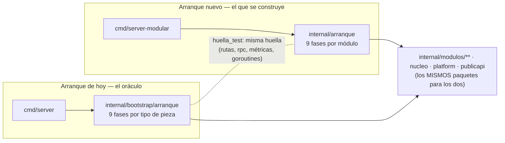

# 04 · La estructura final — cómo quedará el árbol, y cómo se llega por fases

> **Qué es esto.** El dibujo del acabado: cada carpeta y cada fichero de producción de `cmd/` e
> `internal/` tal como quedarían **al terminar** la reorganización, con su origen al lado. Es una
> guía visual y, a la vez, el insumo del script de reescritura (§4).
>
> ✎ **2026-10-11 (F10-04b)**: el relevo está hecho y el código viejo, borrado. **§3 se regeneró desde el código**
> (`go list`, con el comando escrito allí) y es el árbol real, por paquete. §0–§2, §4 y §5 se quedan como estaban: son
> el plan del 2026-09-27, con las rutas de un árbol que ya no existe. Estado: [`ESTADO.md`](ESTADO.md).
>
> **Generado, no escrito a mano.** El árbol de §3 sale de `go list` sobre `dev` @ `b1ad679c` (2026-10-11).

---

## 0 · Qué da por decidido este dibujo

El árbol asume las **recomendaciones** de [`03`](03-pendientes-y-contratos.md) §3. Si Jhoan decide
otra cosa, el dibujo cambia así:

| Decisión | Se asume | Si se decide lo contrario… |
|---|---|---|
| D-1 alcance | Opción 2: mover **y** corregir ubicaciones | Opción 1: desaparecen `modulos/catalogo/catalog.go`, `nucleo/` y los ✎ de `platform` |
| D-2 forma | `internal/modulos/<módulo>/` | Se quita el nivel `modulos/` |
| D-3 aplanar | Sí: `flujos/runtime` → `conversacion/runtime` | Se conserva el nivel intermedio: `conversacion/flujos/runtime` |
| D-4 renombrar | **No**: la carpeta hoja conserva el nombre del paquete | — (con **una** excepción obligada: `indice`, §5) |
| D-5 módulos | La candidata de `02` §4, con `acceso` y `operador` **fusionados** (así se deshace el ciclo 1) | Aparece `modulos/operador/` con `platformadmin` y `entitlements` |
| D-6 / D-10 `publicapi` | ~~Cara HTTP única, no se reparte~~ · 🔒 **Sustituido por D-10 (2026-09-27): «cara única nueva por olas, `internal/apipublica`»**, montada delante de `publicapi` (estrangulador) y alimentada fase a fase; `publicapi` se borra en F10. Detalle en [`plan/FX-cara-http/`](plan/FX-cara-http/README.md) | — (decidido por Jhoan) |

**Leyenda**: `← origen` carpeta movida sin tocar su contenido · ✚ nuevo · ↦ fichero que viene de
otro sitio · ✎ cambia su contenido (no solo sus imports) · 🔒 no se toca · `(+ N _test.go)` los
tests del paquete, que viajan con él.

> Todo fichero movido cambia **sus líneas de import** y las rutas citadas en sus comentarios.
> Eso no se marca con ✎: lo hace el script. ✎ señala solo cambios de lógica o de forma.

---

## 1 · Vista de pájaro

```
cmd/                      los binarios — no se mueven
internal/
├── arranque/             ✚ el cableado, ordenado por módulo (sustituye a bootstrap/)
├── apipublica/           ✚ la cara HTTP /api/v1, única y NUEVA, construida por olas (D-10) — ver plan/FX-cara-http/
├── platform/             soporte transversal: config, cripto, métricas, BD… — no es módulo
├── nucleo/               ✚ lo que comparten varios módulos (la identidad de contacto)
└── modulos/              ✚ el negocio, un directorio por módulo
    ├── acceso/           quién eres y qué puedes: IAM, planes y derechos, operador de plataforma
    ├── edge/             el túnel con cada Edge: gRPC, enrolamiento, lease, flota, acuses
    ├── conversacion/     el Motor de Flujos y sus módulos (menú, encuesta, carrito, media)
    ├── catalogo/         el catálogo del tenant: modelo, índice de búsqueda e importador
    ├── captacion/        la cola que convierte una conversación en borrador (P2→P4, match, draft)
    ├── inferencia/       el LLM: vía local|api, prompts, credencial del tenant, degradación
    └── solicitudes/      la solicitud y su vida: bandeja, estados, P5, CRM
```

De **29 cajas planas** se pasa a **7 módulos + 4 piezas de soporte**. La pregunta «¿dónde está
lo del CRM?» se contesta mirando el árbol, no leyendo 707 ficheros.

---

## 2 · Cómo se llega: por fases, con dos arranques en paralelo

### 2.1 · La idea

Durante la transición conviven **dos puntos de entrada**, y los dos compilan siempre:

```
cmd/
├── server/                → internal/bootstrap → internal/bootstrap/arranque/   (el de hoy: el que se despliega)
└── server-modular/     ✚  → internal/arranque/                                  (el nuevo: nueve fases por módulo)
    ├── main.go            copia de cmd/server/main.go que llama a arranque.Ejecutar
    └── integration_test.go copia del e2e de cmd/server, contra el arranque nuevo
```



Los **paquetes son los mismos** para los dos binarios: cuando una ola mueve un paquete, el
script reescribe los imports de **ambos** arranques. Lo que difiere es **solo el cableado**: el
viejo conserva su forma y sirve de **oráculo**; el nuevo se reorganiza por módulo ola a ola, y un
test compara las huellas de los dos.

### 2.2 · Lo que protege, y lo que no (para no confiarse)

| Protege | No protege |
|---|---|
| **El re-cableado**: si el arranque nuevo olvida una ruta, una goroutine o un hook, la huella lo delata frente al viejo | **El movimiento de paquetes**: afecta a los dos binarios por igual. Eso lo protegen el compilador, los candados AST (`01` §3.1) y los gates |
| **La marcha atrás del cableado**: hasta el relevo, UAT puede seguir desplegando `cmd/server` | Una vuelta atrás de un paquete movido: eso es un `git revert` de la ola |

🔴 **Nunca los dos binarios a la vez contra la misma BD o los mismos puertos.** Los dos migran al
arrancar, los dos escuchan `:8100-8103`, los dos lanzarían las cinco goroutines de fondo (dos
agregadores con ventanas **en memoria** partirían las ráfagas) y el Edge solo se conecta a uno. El
nuevo se prueba en local, en el e2e, o **en sustitución** del viejo en UAT, nunca a su lado.

**Coste de la idea**: mientras dure la transición hay **dos cableados que mantener** (y los 11
candados AST de cableado, duplicados). Por eso exige la **ventana de congelación** de `03` §2
(P-5): si entra una funcionalidad nueva, hay que cablearla en los dos.

### 2.3 · Las fases

> ⚠️ **Sustituida por [`05`](05-metodo-contratos-y-tdd.md) §6** (2026-09-27): el método ya no es
> mover sino reconstruir por contratos y TDD, y el relevo pasa a ser **F10**, tras una **F9** de
> integración por procesos. Se conserva para ver de dónde se partió.

| Fase | Qué se hace | Qué NO se hace | Cómo se sabe que salió bien |
|---|---|---|---|
| **F0 · Andamiaje** | `cmd/server-modular` + `internal/arranque` como **copia exacta** del arranque de hoy · `huella_test.go` · `modulos/fronteras_test.go` en modo **medición** · el script de reescritura con la tabla de §4 | No se mueve ni un paquete | Huellas idénticas · los dos e2e verdes · gates |
| **F1 · Base** | `platform` deja de depender de dominios (los tres ✎ de §3) · `flujos/contact` → `nucleo/contact` | — | El ciclo 1 de `02` §4 desaparece del script de medición |
| **F2 · inferencia** | Mover `llmvia`, `prompts`, `tenantllm`, `degradation` · crear `fase4_inferencia.go` en el arranque nuevo | — | Es pequeño: **valida el script** antes de las olas grandes |
| **F3 · acceso** | Mover `iam/**`, `platformadmin`, `entitlements` · `fase2_acceso.go` | Partir `auth.go` (se anota, no se hace) | Candado I-CP-5 (`platform_permissions_test`) sigue detectando `platformadmin.` |
| **F4 · edge** | Mover `gateway/**`, `diagnostics`, `inferstats`, `receipts`, `ingest`, `filtercfg` · `fase3_edge.go` | Tocar `lease` más allá de su ruta | El test del literal del aviso pasivo sigue encontrando su `.md` |
| **F5 · solicitudes** | Mover `intakes/**`, `integrations/**`, `contracts`, `tenantvars` · `cart/note.go` → `intakes/note.go` | — | Los tres tests del contrato CRM encuentran `docs/contracts/` |
| **F6 · catálogo** | Extraer `cart/catalog.go` a `modulos/catalogo/` · `intake/catalogo` → `catalogo/indice` · mover `catalogimport` | Sacar `revalidate.go` del carrito (usa sus internos, §5) | 🔴 La constante de `frontera_test.go:20` actualizada **a mano** |
| **F7 · captación** | Mover `intake`, `pipeline`, `stages`, `anclaje`, `intakeahead`, `evidence`, `reanalisis`, `casebank`, `intentcfg` | — | `inv1_aprobar_ast_test` lee sus seis directorios |
| **F8 · conversación** | Mover `flujos/**` y `turnoacotado` · `fase7_conversacion.go` | Cortar el ciclo de negocio (`02` §4, D-7) | Es la ola más grande (~25k l de prod, ~48k de test) |
| **F9 · Relevo** | `cmd/server` pasa a llamar a `internal/arranque` · se borran `internal/bootstrap/` y `cmd/server-modular/` · `fronteras_test` pasa a modo **estricto** | — | Un despliegue de UAT con el binario de siempre (`go build -o bin/server ./cmd/server`) |

Cada ola termina con el repo **verde y desplegable**, y se deshace con un `git revert`. El orden
F2→F8 va de lo pequeño a lo grande a propósito: las primeras olas prueban el script donde un fallo
cuesta poco.

---

## 3 · El árbol completo, tal como quedó tras el relevo

> ✎ **2026-10-11 (F10-04b, T10.14)**: **regenerado desde el código**, sobre `dev` @ `b1ad679c`. Sustituye al dibujo del
> 2026-09-27, que era una previsión fichero a fichero con el origen de cada uno y nunca se cotejó con lo construido
> (deuda D-40, que esto cierra). Va por **paquete**, no por fichero: el detalle de un paquete se lee con `ls`.

Comando (desde la raíz del repo; las dos etiquetas hacen que cuenten también los ficheros de `test/procesos/`):

```bash
GOTOOLCHAIN=go1.26.5 GOWORK=off go list -tags integracion,edgereal \
  -f '{{.ImportPath}} {{len .GoFiles}} {{len .TestGoFiles}} {{len .XTestGoFiles}}' ./... \
  | sed 's|^github.com/EduGoGroup/wapp-cloud-platform/||' \
  | awk '{printf "%-62s %3d prod · %3d test\n", $1, $2, $3+$4}'
```

Regla de conteo: un paquete por línea, tal como lo ve `go list` (no entra `testdata/`); «prod» son sus `.go` que no
terminan en `_test.go` —los paquetes `…helpertest`, que son suites de contrato, cuentan ahí— y «test», los `_test.go`
del paquete más los del paquete externo `_test`. **Total: 108 paquetes, 608 ficheros de producción y 899 de test.**

```
cmd/casebank                                                     1 prod ·   1 test
cmd/cobertura-ficheros                                           1 prod ·   1 test
cmd/debug_inferencia                                             1 prod ·   0 test
cmd/migrate                                                      1 prod ·   0 test
cmd/prompts                                                      1 prod ·   0 test
cmd/server                                                       1 prod ·   1 test
internal/apipublica                                             47 prod ·  78 test
internal/apipublica/apipublicahelpertest                         1 prod ·   1 test
internal/apipublica/eventstelemetryhelpertest                    3 prod ·   1 test
internal/arranque                                               28 prod ·  34 test
internal/arranque/huellatest                                     2 prod ·   3 test
internal/candados                                               11 prod ·  12 test
internal/modulos                                                 1 prod ·   5 test
internal/modulos/acceso/entitlements                             3 prod ·   7 test
internal/modulos/acceso/entitlements/entitlementshelpertest      2 prod ·   1 test
internal/modulos/acceso/iam/domain                               4 prod ·   4 test
internal/modulos/acceso/iam/infra/identity                       4 prod ·   7 test
internal/modulos/acceso/iam/infra/memory                         8 prod ·   8 test
internal/modulos/acceso/iam/infra/postgres                       8 prod ·  14 test
internal/modulos/acceso/iam/ports/in                             3 prod ·   1 test
internal/modulos/acceso/iam/ports/out                            3 prod ·   0 test
internal/modulos/acceso/iam/ports/out/outhelpertest              8 prod ·   0 test
internal/modulos/acceso/iam/transport/http                       6 prod ·   6 test
internal/modulos/acceso/iam/usecase                             11 prod ·  15 test
internal/modulos/acceso/platformadmin                            6 prod ·  10 test
internal/modulos/acceso/platformadmin/platformadminhelpertest    7 prod ·   1 test
internal/modulos/captacion/anclaje                               1 prod ·   4 test
internal/modulos/captacion/casebank                              5 prod ·   7 test
internal/modulos/captacion/casebank/casebankhelpertest           2 prod ·   1 test
internal/modulos/captacion/evidence                              1 prod ·   1 test
internal/modulos/captacion/intake                                7 prod ·  10 test
internal/modulos/captacion/intake/intakehelpertest              10 prod ·   2 test
internal/modulos/captacion/intakeahead                           4 prod ·   8 test
internal/modulos/captacion/intentcfg                             2 prod ·   3 test
internal/modulos/captacion/intentcfg/intentcfghelpertest         1 prod ·   0 test
internal/modulos/captacion/pipeline                              6 prod ·  13 test
internal/modulos/captacion/pipeline/pipelinehelpertest           1 prod ·   1 test
internal/modulos/captacion/reanalisis                            4 prod ·   5 test
internal/modulos/captacion/stages                               14 prod ·  31 test
internal/modulos/catalogo                                        1 prod ·   4 test
internal/modulos/catalogo/catalogimport                         11 prod ·  14 test
internal/modulos/catalogo/indice                                 3 prod ·   8 test
internal/modulos/conversacion/admin                              6 prod ·   6 test
internal/modulos/conversacion/content                            4 prod ·   4 test
internal/modulos/conversacion/engine                             2 prod ·   5 test
internal/modulos/conversacion/events                            11 prod ·  13 test
internal/modulos/conversacion/events/eventshelpertest           12 prod ·   1 test
internal/modulos/conversacion/model                              1 prod ·   1 test
internal/modulos/conversacion/modules                            5 prod ·   5 test
internal/modulos/conversacion/modules/cart                      20 prod ·  28 test
internal/modulos/conversacion/modules/media                      1 prod ·   1 test
internal/modulos/conversacion/modules/menu                       1 prod ·   1 test
internal/modulos/conversacion/modules/survey                     2 prod ·   2 test
internal/modulos/conversacion/runtime                           40 prod ·  65 test
internal/modulos/conversacion/runtime/runtimehelpertest          7 prod ·   3 test
internal/modulos/conversacion/store                             12 prod ·  15 test
internal/modulos/conversacion/store/storehelpertest             15 prod ·   0 test
internal/modulos/conversacion/trigger                            5 prod ·   8 test
internal/modulos/conversacion/trigger/triggerhelpertest          2 prod ·   0 test
internal/modulos/conversacion/turnoacotado                       3 prod ·   3 test
internal/modulos/edge/diagnostics                                2 prod ·   4 test
internal/modulos/edge/diagnostics/diagnosticshelpertest          4 prod ·   1 test
internal/modulos/edge/enroll                                     7 prod ·   8 test
internal/modulos/edge/enroll/enrollhelpertest                    3 prod ·   1 test
internal/modulos/edge/filtercfg                                  1 prod ·   1 test
internal/modulos/edge/fleet                                      6 prod ·   9 test
internal/modulos/edge/fleet/fleethelpertest                      7 prod ·   2 test
internal/modulos/edge/grpc                                      21 prod ·  54 test
internal/modulos/edge/inferstats                                 1 prod ·   1 test
internal/modulos/edge/ingest                                     2 prod ·   4 test
internal/modulos/edge/ingest/ingesthelpertest                    2 prod ·   1 test
internal/modulos/edge/lease                                      4 prod ·   8 test
internal/modulos/edge/lease/leasehelpertest                      4 prod ·   1 test
internal/modulos/edge/receipts                                   3 prod ·   4 test
internal/modulos/edge/receipts/receiptshelpertest                2 prod ·   1 test
internal/modulos/edge/session                                    1 prod ·   2 test
internal/modulos/inferencia/degradation                          2 prod ·   4 test
internal/modulos/inferencia/degradation/degradationhelpertest    4 prod ·   1 test
internal/modulos/inferencia/llmvia                               3 prod ·  10 test
internal/modulos/inferencia/llmvia/local                         3 prod ·   4 test
internal/modulos/inferencia/prompts                              2 prod ·   2 test
internal/modulos/inferencia/tenantllm                            2 prod ·   3 test
internal/modulos/inferencia/tenantllm/tenantllmhelpertest        4 prod ·   1 test
internal/modulos/solicitudes/intakes                            42 prod ·  60 test
internal/modulos/solicitudes/intakes/intakeshelpertest          10 prod ·   0 test
internal/modulos/solicitudes/intakes/quotetext                   6 prod ·   9 test
internal/modulos/solicitudes/intakes/telemetria                  1 prod ·   1 test
internal/modulos/solicitudes/integrations                        8 prod ·  18 test
internal/modulos/solicitudes/integrations/crmpush                2 prod ·   5 test
internal/modulos/solicitudes/integrations/integrationshelpertest   7 prod ·   1 test
internal/modulos/solicitudes/integrations/sigv1                  1 prod ·   1 test
internal/modulos/solicitudes/tenantvars                          3 prod ·   4 test
internal/modulos/solicitudes/tenantvars/tenantvarshelpertest     1 prod ·   0 test
internal/nucleo/contact                                          4 prod ·   4 test
internal/nucleo/contact/contacthelpertest                       10 prod ·   1 test
internal/nucleo/errhelpertest                                    1 prod ·   1 test
internal/platform/config                                         1 prod ·   1 test
internal/platform/crypto                                         5 prod ·   4 test
internal/platform/httpapi                                        6 prod ·   9 test
internal/platform/logging                                        1 prod ·   1 test
internal/platform/metrics                                        2 prod ·   4 test
internal/platform/metrics/flowlifecycle                          1 prod ·   0 test
internal/platform/metrics/inferencia                             1 prod ·   0 test
internal/platform/ratelimit                                      1 prod ·   1 test
internal/platform/storage/objectstore                            2 prod ·   1 test
internal/platform/storage/postgres                               3 prod ·   3 test
internal/platform/storage/postgres/migrations                    4 prod ·   1 test
test/procesos                                                    1 prod · 158 test
```

---

## 4 · La tabla de correspondencia — lo que usará el script

Una sola tabla, aplicada **a la vez** a imports, comentarios y documentación (`01` §3.2). Gana el
prefijo más largo: `internal/flujos/contact` va a `nucleo/` aunque `internal/flujos` vaya a
`conversacion/`.

| Ruta de hoy | Ruta nueva |
|---|---|
| `internal/bootstrap` + `internal/bootstrap/arranque` | `internal/arranque` (en el relevo) |
| `internal/iam` | `internal/modulos/acceso/iam` |
| `internal/platformadmin` · `internal/entitlements` | `internal/modulos/acceso/…` (mismo nombre) |
| `internal/gateway` | `internal/modulos/edge` (aplanado: `gateway/grpc` → `edge/grpc`) |
| `internal/diagnostics` · `inferstats` · `receipts` · `ingest` · `filtercfg` | `internal/modulos/edge/…` |
| `internal/flujos` | `internal/modulos/conversacion` (aplanado) |
| `internal/flujos/contact` | `internal/nucleo/contact` |
| `internal/turnoacotado` | `internal/modulos/conversacion/turnoacotado` |
| *(nuevo, desde `flujos/modules/cart/catalog.go`)* | `internal/modulos/catalogo` |
| `internal/intake/catalogo` | `internal/modulos/catalogo/indice` ⚠️ renombre |
| `internal/catalogimport` | `internal/modulos/catalogo/catalogimport` |
| `internal/intake` | `internal/modulos/captacion/intake` |
| `internal/intake/pipeline` · `stages` · `anclaje` | `internal/modulos/captacion/…` (aplanado) |
| `internal/intakeahead` · `evidence` · `reanalisis` · `casebank` · `intentcfg` | `internal/modulos/captacion/…` |
| `internal/llmvia` · `prompts` · `tenantllm` · `degradation` | `internal/modulos/inferencia/…` |
| `internal/intakes` · `integrations` · `contracts` · `tenantvars` | `internal/modulos/solicitudes/…` |
| `internal/platform` | **sin cambio** |
| `internal/publicapi` | 🔒 **D-10**: sustituido **ruta a ruta** por `internal/apipublica` según [`plan/FX-cara-http/mapa-de-rutas.md`](plan/FX-cara-http/mapa-de-rutas.md); se borra en F10 |

---

## 5 · Tres decisiones de detalle que el dibujo ya toma (y por qué)

1. **`indice` es el único paquete que cambia de nombre.** El modelo extraído del carrito se llama
   `catalogo`, y el índice de búsqueda de `intake/catalogo` **también** se llama `catalogo`: el
   worker del pipeline necesita los dos, y dos paquetes homónimos obligarían a alias en cada
   import. Se renombra el índice, no el modelo. **Sus textos de error no cambian** (`"catalogo: …"`
   es un literal, no se deriva del nombre del paquete): el renombre no toca nada observable.
2. **`revalidate.go` se queda en el carrito.** `catalog.go` y `note.go` son autocontenidos
   (medido: no usan ningún identificador del resto del carrito; `catalog.go` solo importa
   `conversacion/model`, ver abajo), pero `revalidate.go` usa
   `cartLine`, `lineLabel`, `money`, `summaryWith` y `variantSKUSuffix`, y `PriceListOf` devuelve
   un `intakes.PriceList`. Además nadie fuera del carrito la llama en producción (las dos menciones
   son comentarios). Sacarla no aporta y arrastra internos.
   **La única dependencia que se lleva `catalog.go`** es `conversacion/model`: `ParseCatalog`
   recibe un `model.Content` y envuelve `model.ErrInvalidFlow`. Se acepta: `model` es una
   **hoja** (no importa nada interno, medido con `go list`), así que la arista
   `catalogo → conversacion/model` no puede formar ciclo. Cambiar la firma alteraría el
   `errors.Is(err, model.ErrInvalidFlow)` de quien la consume, y eso sí sería cambiar
   comportamiento.
3. **`note.go` va a `solicitudes/intakes`, no a `catalogo`.** Su cabecera lo dice: es *el
   contrato de contenido de dos columnas* de la solicitud (`intake_items.customization` e
   `intakes.customer_note`), con una regla para las dos puertas (carrito y pipeline). Su dueño
   natural es quien tiene esas columnas. El carrito ya importa `intakes`, así que no nace ninguna
   dependencia nueva.

**Técnica para no romper a nadie en F5 y F6**: al sacar `catalog.go` y `note.go`, el carrito puede
dejar **alias de tipo** temporales (`type Catalog = catalogo.Catalog`,
`var SanitizeNote = intakes.SanitizeNote`) para que sus consumidores migren en la misma ola sin
prisa, y borrarlos al cerrarla. Si el script reescribe todos los consumidores de golpe, no hacen
falta.
